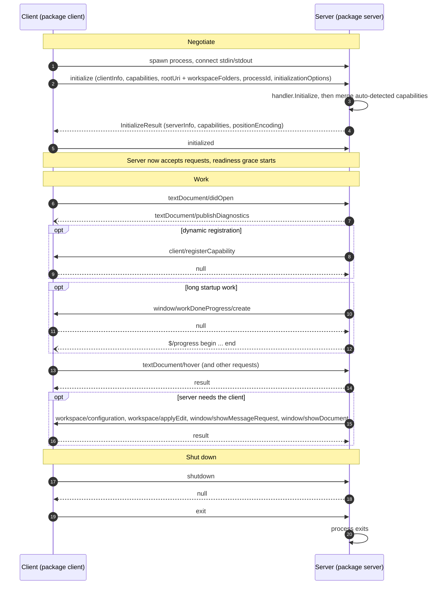

# Handshake and Message Order

Every LSP session runs in the same order: negotiate, work, shut down. The order is not advisory. A server must reject work before `initialize`, and a client that skips `initialized` leaves the server dropping its notifications.

## The sequence

## What negotiation actually decides

| Decided at | What |
| --- | --- |
| Client capabilities in `initialize` | Which server→client requests the client will honour, and which dynamic registrations it will act on. `DefaultCapabilities` advertises `dynamicRegistration` only where `Client` honours it, because over-declaring makes a server withhold static capabilities. |
| Server capabilities in `InitializeResult` | Which requests the client may send. go-lsp builds these from the interfaces your handler implements and merges them into whatever your `Initialize` returned, so explicit values win. |
| `positionEncoding` | How offsets in every later position are read. The client defaults to UTF-16 and switches only if the server names another encoding. `DefaultCapabilities` offers UTF-16 alone. |
| `client/registerCapability`, after the fact | Capabilities the server adds later. `Client.Supports(method, uri, languageID)` answers over both the static set and the live registrations. |

## Rules the server enforces

- A request before `initialize` completes fails with `-32002` (`ServerNotInitialized`).
- A second `initialize` fails with `InvalidRequest`. A failed `initialize` resets the state, so the client may retry.
- Notifications outside the initialized window are dropped, except `exit`.
- After `shutdown`, every request fails with `InvalidRequest`. The diagnostics engine stops before `handler.Shutdown` runs.

## Readiness is not part of the handshake

A server answers `initialize` long before it has indexed anything. Ask for references in that window and the empty list looks like a real answer.

LSP has no readiness signal, so `Client.Ready` approximates one: it tracks work-done progress tokens from `window/workDoneProgress/create` and `$/progress`, and reports ready when none are outstanding. For a server that reports no progress at all, it waits out `Config.ReadyGrace` (2s by default), timed from the end of `initialize`. Requests are never blocked on it.

See [`client.md`](./client.md) for the client API and [`documents.md`](./documents.md) for position encoding in practice.
